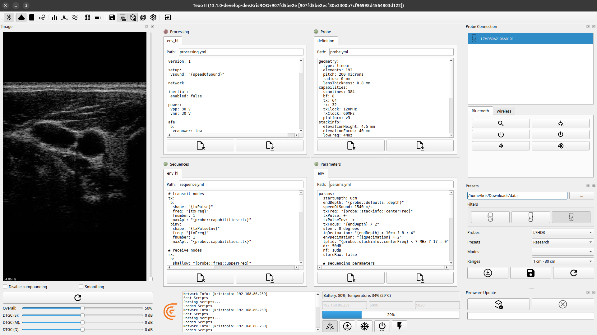
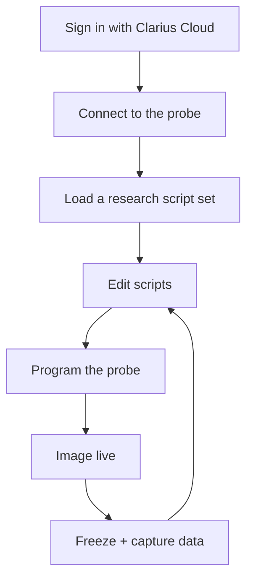
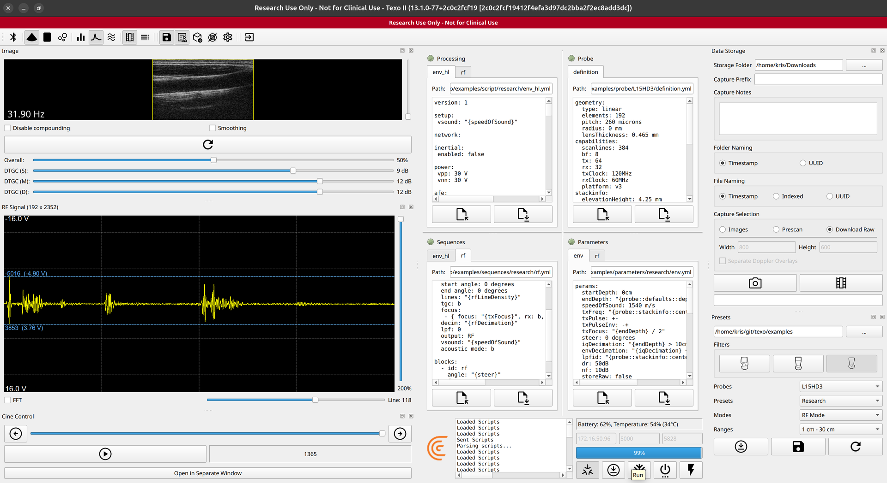

# Getting Started with Texo

This guide walks through a Texo session: signing in, connecting to a probe, loading a
research script set, programming the probe, imaging, and capturing data. For a tour of the
window itself, including the four script windows, image panel, probe connection and
presets, see [The Texo Workspace](interface.md).



## The big picture

Texo replaces the App's automatic optimization with explicit scripts you control:



## Before you start

- Download Texo for your platform from
  [Releases](https://github.com/clariusdev/texo/releases), and see the release notes for
  per-platform setup.
- Get the matching example scripts: clone this repository, or download its source archive
  from the same release. Use the examples tagged with your Texo version, since script
  syntax can change between releases.

## 1. Sign in

Texo requires a Clarius Cloud account with research/Texo permissions. On launch, sign in;
your account determines which probes and research script sets you can access. (You stay
signed in for the session; closing the login without signing in exits.)

## 2. Connect to a probe

Texo works with Clarius HD3 probes that have research access enabled.

1. Open the **Probe Connection** panel and stay on its **Bluetooth** tab.
2. Search, select your probe, and power it on from the panel.
3. Once the probe reports its network over Bluetooth, Texo connects to it over Wi-Fi
   automatically and the log shows *Connected to Probe*. Your computer must be on the
   same network as the probe.

If the automatic connection doesn't happen, enter the probe's **IP address** and
**port** in the connection bar at the bottom of the window and press **Connect**.

Once connected, Texo shows probe status (battery, temperature) and enables the imaging
buttons. If the log reports that the probe software differs from the bundled build, update
it from the **Firmware Update** panel before imaging.

## 3. Load a research script set

The research script sets ship in this repository's [`examples/`](../examples) folder, laid
out as a Texo data folder:

```
examples/
  applications/   presets (Research, Envelope Sequence, Channels Sequence)
  probe/          probe definitions, one folder per HD3 model
  script/         processing scripts
  sequences/      sequences
  parameters/     parameters
```

In the **Presets** panel:

1. Click **...** and choose the `examples` folder.
2. Turn on the **HD3** filter. The probe filters start off, so the probe list is empty
   until you do.
3. Pick your **Probe**, then a **Preset** and depth **Range**. Optionally pick a **Mode**
   (Color Doppler, PW, M, RF, …) to add on top of B mode.
4. Press **Load**.

Texo fills its **four editor windows**. Every script is made of the same four parts,
arranged in two columns:

| Window | Part | What it defines |
|--------|------|-----------------|
| **Probe** | Probe definition | Geometry, frequency band, capabilities. |
| **Parameters** | Parameters | Named values/expressions (frequency, focus, aperture, decimation, gain, …). |
| **Sequences** | Sequence | The transmit/receive sequence and frame structure, built from parameters. |
| **Processing** | Image processing | The pipeline applied to acquired data. |

The B-mode scripts for the chosen range open in the first tab of each window. A chosen
mode adds its own scripts as further tabs (e.g. `env_hl` and `cfi`), and all tabs in a
window are sent together.

See the [Scripting Guide](scripting.md) for what goes in each window and how they
reference one another.

## 4. Edit

Edit any window directly. Imaging depth, for example, is the `endDepth` parameter in the
Parameters window. Each window has an indicator next to its title that turns green once
it has parsed, and resets when you edit it.

To keep your changes, use the load/save buttons under each window to write a tab to a
file of your own. The Presets panel's **Save** writes every tab back over the files it was
loaded from, so copy `examples/` first if you want to keep the originals.

## 5. Program the probe and image

Press **Program Probe**. Texo parses all four windows and, if they're valid, sends the
parameters, sequences, processing, and probe definition to the probe. The log shows
*Parsing scripts...*, *Sent Scripts*, then *Loaded Scripts*. If a window has an error, the
log reports it and the offending line is selected in that window.

Press **Run** to start imaging and again to freeze. Texo images with exactly the settings
your scripts specify; no depth-based auto-optimization happens behind your back. After
any edit, press **Program Probe** again to apply it.

## 6. Capture data

Open the **Data Storage** panel (save icon in the toolbar):

1. Choose the **Storage Folder**, and optionally a **Capture Prefix** and **Capture Notes**.
2. Choose how folders and files are named: timestamp, index, or UUID.
3. Under **Capture Selection**, choose what to save:
   - **Images**: scan-converted images at the width × height you set, optionally with
     Doppler overlays saved as separate frames.
   - **Prescan**: images before scan conversion.
   - **Download Raw**: raw data from the probe's buffer.
4. Press **Capture Image** for the current frame or **Capture Cine** for the buffered
   loop.

Image and prescan captures also save the four scripts in use (`script.yml`,
`sequences.yml`, `probe.yml`, `parameters.yml`) alongside the images, so every capture
records the settings that produced it. See [Capture Output and Reading the
Data](capture-data.md) for the folder layout.

### Raw data

The probe only buffers raw data when the scripts tell it to. The example parameter files
set `storeRaw: false`; change it to `storeRaw: true` in the Parameters window and press
**Program Probe** before imaging. Otherwise **Download Raw** reports *No Raw Data
Buffered*.



Raw data uses the on-disk formats documented in the
[research repository](https://github.com/clariusdev/research/blob/master/docs/raw-data-format.md),
so the existing readers apply. See [Capture Output and Reading the Data](capture-data.md)
for the package contents and Python examples.

## Troubleshooting

| Symptom | Fix |
|---------|-----|
| The **Probes** list is empty | Turn on the **HD3** filter in the Presets panel. |
| *Application '…' Cannot be Loaded* | The data folder holds scripts from a different Texo version, or an incomplete script set. Use the examples tagged with your Texo release. |
| *Probe software … differs from bundled …* | Update the probe from the **Firmware Update** panel. |
| *Script Error: …* after **Program Probe** | Fix the line selected in the reported window and program again. |
| *No Raw Data Buffered* | Set `storeRaw: true`, program the probe, and image before downloading. Downloading empties the buffer, so image again before the next download. |
| The raw `.zip` won't extract | Its entries use Zstandard compression; extract with Python 3.14 or later (see [Reading raw data](capture-data.md#reading-raw-data-in-python)). |

## Safety

Texo scripts set acoustic and beamforming parameters directly and can drive the
transducer outside the optimized, validated operating points that the Clarius App
maintains. Use appropriate test equipment, and stay within your regulatory obligations
when changing transmit frequency, voltage, pulse shape, or aperture. See the related
[low-level parameter](https://github.com/clariusdev/research/blob/master/docs/low-level-parameters.md)
safety notes.

## Where to go next

- [Capture Output and Reading the Data](capture-data.md): what lands on disk and how to load it
- [Scripting Guide](scripting.md): the script sections and expression language
- [How imaging parameters are automated](https://github.com/clariusdev/research/blob/master/docs/imaging-parameter-automation.md):
  the model Texo scripts build on
