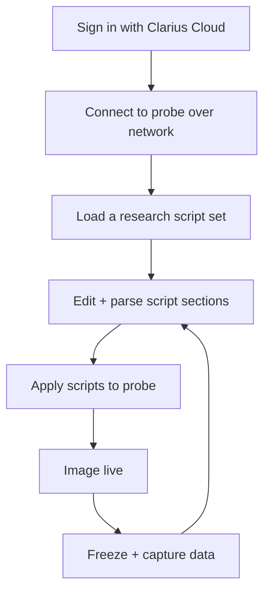

# Getting Started with Texo

> 🚧 **Pre-release.** Workflow and screens described here are subject to change before
> Texo is generally available. UI walkthroughs/screenshots will be added.

This guide walks through a Texo session: signing in, connecting to a probe, loading a
research script set, applying it, imaging, and capturing data. For a tour of the window
itself — the four script windows, image panel, probe connection, and presets — see
[The Texo Workspace](interface.md).


## The big picture

Texo replaces the App's automatic optimization with explicit scripts you control:



## 1. Sign in

Texo requires a Clarius Cloud account with research/Texo permissions. On launch, sign in;
your account determines which probes and research script sets you can access. (You stay
signed in for the session; closing the login without signing in exits.)

## 2. Connect to a probe

Power the probe on and ensure it is on the same wireless network as your machine. In Texo,
enter the probe's **IP address** and **port** and connect. As with the other research
APIs, the probe must have research access; authentication uses your signed-in session.

Once connected, Texo shows probe status (battery, temperature) and enables the toolbar
actions for applying scripts and imaging.

## 3. Load a research script set

The research script sets ship in this repository's [`examples/`](../examples) folder, laid
out as a Texo data folder:

```
examples/
  applications/   presets (Research, Envelope Sequence, Channels Sequence)
  probe/          probe definitions, one folder per HD3 model
  script/         processing scripts
  sequences/      sequences
  parameters/     parameters
```

In the **Presets** panel, click **...** and choose the `examples` folder, then turn on the
**HD3** filter (the probe filters start off). Pick your **Probe** and **Preset**, plus a
**Mode** and depth **Range** if the preset offers them, and load. Texo fills its **four
editor windows**. Every script is made of the same four parts, arranged in two columns:

| Window | Part | What it defines |
|--------|------|-----------------|
| **Probe** | Probe definition | Geometry, frequency band, capabilities. |
| **Parameters** | Parameters | Named values/expressions (frequency, focus, aperture, decimation, gain, …). |
| **Sequences** | Sequence | The transmit/receive sequence and frame structure, built from parameters. |
| **Processing** | Image processing | The pipeline applied to acquired data. |

See the [Scripting Guide](scripting.md) for what goes in each window and how they
reference one another.

## 4. Edit and parse

Edit any section in its tab, then parse. Texo parses each section independently and
reports errors with the offending line highlighted, so you can fix issues before sending
anything to the probe. All four sections must parse cleanly before you apply.

You can save your edited scripts back as a named set and reload them later.

## 5. Apply and image

Apply the parsed scripts to the connected probe. Texo sends the parameters, sequences,
processing, and probe definition, then begins imaging with exactly the settings your
scripts specify — no depth-based auto-optimization happens behind your back.

Use the freeze control to start/stop imaging.

## 6. Capture data

Choose a storage folder, then capture while imaging or frozen. Captures are written to
your storage folder for offline analysis. The raw data uses the same on-disk formats
documented in the
[research repository](https://github.com/clariusdev/research/blob/master/docs/raw-data-format.md),
so the existing Python/MATLAB readers apply.

## Safety

Texo scripts set acoustic and beamforming parameters directly and can drive the
transducer outside the optimized, validated operating points that the Clarius App
maintains. Use appropriate test equipment, and stay within your regulatory obligations
when changing transmit frequency, voltage, pulse shape, or aperture. See the related
[low-level parameter](https://github.com/clariusdev/research/blob/master/docs/low-level-parameters.md)
safety notes.

## Where to go next

- [Scripting Guide](scripting.md) — the script sections and expression language
- [How imaging parameters are automated](https://github.com/clariusdev/research/blob/master/docs/imaging-parameter-automation.md)
  — the model Texo scripts build on
