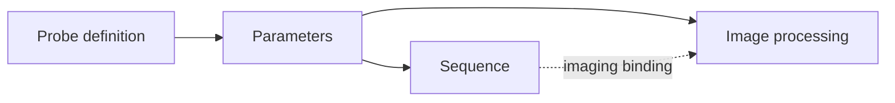
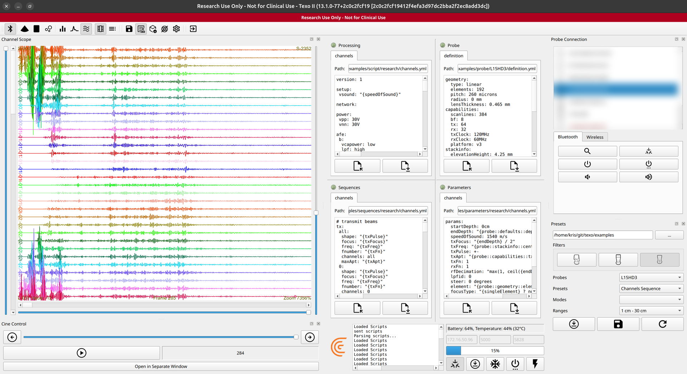

# Texo Scripting Guide

**Every Texo script is made of the same four parts.** They appear as four editor windows
in the Texo workspace, laid out in two columns:

```
┌───────────────────────┬───────────────────────┐
│  Processing           │  Probe                │
│  (image processing)   │  (probe definition)   │
├───────────────────────┼───────────────────────┤
│  Sequences            │  Parameters           │
│  (transmit/receive)   │  (named values)       │
└───────────────────────┴───────────────────────┘
```

| Window | Part | What it defines |
|--------|------|-----------------|
| Probe | **Probe definition** | The transducer's fixed properties — geometry, frequency band, capabilities. |
| Parameters | **Parameters** | Named values/expressions (frequency, focus, aperture, decimation, gain, …), which may reference the probe. |
| Sequences | **Sequence** | The transmit/receive events and frame layout, built from parameters. |
| Processing | **Image processing** | How acquired data is turned into images and data streams. |

Each window is **parsed independently**, and all four must parse cleanly before the script
is applied to the probe. Conceptually they layer from the hardware up to the
final image:



Parameters resolve from the probe, then feed **both** the sequence and the processing; the
sequence and processing are joined by an `imaging` binding (see
[How parameters feed the sequence and processing](#how-parameters-feed-the-sequence-and-processing)).

All four are written in YAML and share one **expression language**, so a value set in one
window flows through the rest.

## The expression language

Values are expressions, not just literals:

- **References** — `{name}` pulls another parameter; `{probe::section::field}` pulls a
  field from the probe definition (e.g. `{probe::freq::upperFreq}`,
  `{probe::geometry::elements}`).
- **Units are first-class** — `5MHz`, `40mm`, `15dB`, `20Hz`, `7.5 degrees`; arithmetic
  respects them.
- **Conditionals** — ternaries select values from flags, e.g.
  `"{penetrationMode} ? 35V : 30V"`.
- **Math** — `+ - * /`, `min`, `max`, `ceil`, etc., e.g.
  `"max(1, ceil({endDepth} / 4cm))"`.

For a deeper tour of how these expressions drive real imaging behavior (the depth-based
frequency slide, decimation, auto gain), see
[How Imaging Parameters Are Automated](https://github.com/clariusdev/research/blob/master/docs/imaging-parameter-automation.md)
in the research repo — Texo uses the same model.

## Parameters

Named values consumed by the other sections. A parameter can be a constant or an
expression referencing the probe or other parameters:

```yaml
params:
  startDepth: 0cm
  endDepth: 6cm
  txFreq: "{probe::freq::upperFreq}"   # fix transmit frequency to the probe's high end
  txFn: 1
  txApt: 64
  txFocus: "{endDepth} / 2"
  rxFn: 1
  rfDecimation: "max(1, ceil({endDepth} / 4cm))"
```

This is where research control happens: pin frequency, focus, aperture, decimation, pulse
shape, and gain to the fixed values your experiment needs rather than letting depth drive
them.

## How parameters feed the sequence and processing

Parameters are the single source of truth. The **Sequences** and **Processing** windows
don't hold their own copies of values — they reference parameters by name, so one
parameter can drive inputs in both windows at once. Editing it in the Parameters window
re-derives everything that references it on the next apply.

Take `txFreq` and `endDepth` from the Parameters window:

```yaml
# Parameters
params:
  txFreq: "{probe::stackinfo::centerFreq}"
  endDepth: "{probe::defaults::depth}"
  txFocus: "{endDepth} / 2"
  envDecimation: "{iqDecimation} + 2"
  dr: 50dB
  nf: 10dB
```

The same names appear as **inputs** in the other two windows:

```yaml
# Sequence — transmit frequency and frame extent come from parameters
tx:
  b: { freq: "{txFreq}", ... }
frames:
  b: { end: "{endDepth}", focus: "{txFocus}", decim: "{iqDecimation}", ... }
```

```yaml
# Processing — detection, decimation, and raw-data tagging come from parameters
envlog:
  b: { dynrange: "{dr}", noisefloor: "{nf}", decim: "{envDecimation}" }
rawdata:
  iq: { freq: "{txFreq}", depth: "{endDepth}", focus: "{txFocus}" }
```

So changing `endDepth` once moves the frame extent (sequence), the focus
(`txFocus = endDepth / 2`, used in both), the envelope decimation (processing), and the
metadata stamped onto captured raw data — all consistently. This is the same expression
model the Clarius App uses internally; in Texo you control the parameter values directly.

The **probe** definition sits upstream of all of it: parameters resolve probe fields
(`{probe::stackinfo::centerFreq}`, `{probe::freq::upperFreq}`, …), which then flow into the
sequence and processing. The dependency order is **probe → parameters → sequence &
processing**.

## Sequences

The sequence describes the **transmit/receive events** that acquire a frame. Every
sequence starts the same way — by declaring named **`tx`** (transmit) and **`rx`**
(receive) nodes that reference parameters:

```yaml
tx:
  b:
    shape: "{txPulse}"
    freq: "{txFreq}"
    fnumber: 1
    maxApt: "{probe::capabilities::tx}"

rx:
  b:
    shallow: "{probe::freq::upperFreq}"
    deep: "{probe::freq::lowFreq}"
    fnumber: 1
    type: dynamic
    apod: b
```

What differs between sequence types is **how you lay out the events** that use those
nodes. Texo offers two authoring styles, exposed as different presets.

### Three sequences, two styles

| Sequence | Style | You write | Output |
|----------|-------|-----------|--------|
| **research** (high-level) | pattern | A scan region + a few focus rules; Texo expands the per-line events. | Beamformed IQ / envelope scanlines |
| **envelope** (low-level) | event-by-event | Every scanline event, by hand. | Beamformed IQ / envelope scanlines |
| **channels** (low-level) | event-by-event | Every event, receiving one channel at a time. | Raw per-channel data (pre-beamforming) |

The **research** preset is available for **all probes** and is the easiest starting
point. The **envelope** and **channels** sequences trade conciseness for complete,
explicit control of every event.

### High-level sequences (`research`)

You describe the frame as a **region and a pattern**, and the system generates one
acquisition event per line for you. The `frames` block sets the extent (start/end depth,
element range, line count) and a small list of `focus` rules selected by state
(`rxc`, `mla`, harmonics …); `blocks` assembles frames into the acquisition:

```yaml
frames:
  b:
    start: "{startDepth}"
    end: "{endDepth}"
    start element: 0
    end element: "{probe::geometry::elements} - 1"
    lines: "{probe::geometry::elements}"     # how many line events to expand to
    focus:
      - { focus: "{txFocus}", rx: b, tx: b, dtgcs: [ b ], channels: "all",
          enabled: "{rxc} == 32 && {mla} == 1" }
      # additional focus rules for other rxc / mla / harmonic combinations …
    decim: "{iqDecimation}"
    output: IQ

blocks:
  - id: b
    angle: "{steer}"
    frame: b
```

A few dozen lines describe an entire 192-line frame. This is the concise "event pattern"
style — ideal when you want standard scanning with research-level parameter control but
don't need to hand-place every event.

### Event-by-event sequences (`envelope`)

The low-level **envelope** sequence drops the `frames`/`blocks` abstraction and instead
lists events explicitly under `seq` → `events`, one entry per scanline. You write them all
out:

```yaml
seq:
  sla:
    start: "{startDepth}"
    end: "{endDepth}"
    events:
      - { el: "0",  txAngle: "{steer}", rxAngle: "{steer}", lpf: "{lpfid}", tx: b, rx: [ { rx: b } ], tgc: b }
      - { el: "1",  txAngle: "{steer}", rxAngle: "{steer}", lpf: "{lpfid}", tx: b, rx: [ { rx: b } ], tgc: b }
      - { el: "2",  txAngle: "{steer}", rxAngle: "{steer}", lpf: "{lpfid}", tx: b, rx: [ { rx: b } ], tgc: b }
      # … one event per element, through the full aperture
    output: IQ
```

The result is the same kind of beamformed IQ/envelope data as the high-level sequence, but
every event is yours to modify — change the transmit on a specific line, vary angles per
event, interleave different rx nodes, and so on.

### Event-by-event sequences (`channels`)

The **channels** sequence is also written event-by-event, but it captures **raw,
per-channel data before beamforming**. Each event transmits (typically on the full
aperture) and receives a **single channel**, stepping through every receive channel:

```yaml
rx:
  0: { shallow: "{txFreq}", deep: "{txFreq}", channels: 0, type: "{focusType}", apod: ch }
  1: { shallow: "{txFreq}", deep: "{txFreq}", channels: 1, type: "{focusType}", apod: ch }
  # … one rx node per channel

seq:
  ch:
    events:
      - { el: "{element}", txAngle: "{steer}", rxAngle: "{steer}", tx: all, rx: [ { rx: 0 } ], tgc: ch }
      - { el: "{element}", txAngle: "{steer}", rxAngle: "{steer}", tx: all, rx: [ { rx: 1 } ], tgc: ch }
      # … one event per receive channel
```



Because receive focusing can be disabled (`type` resolving to `none`) and each channel is
captured on its own, this yields the **rawest** acquisition — individual element/channel
signals that you can beamform yourself offline. It is the most verbose sequence (one event
per channel, for every element of interest), which is why it is authored explicitly rather
than from a pattern.

### Choosing a sequence

- Start with **research** for standard scanning with research parameter control.
- Use **envelope** when you need to control individual scanline events but still want
  beamformed output.
- Use **channels** when you need raw per-channel data to run your own beamforming or
  channel-level analysis.

In all three, the `tx`/`rx` nodes and events reference parameters and the probe, so editing
a value in the Parameters window re-derives the sequence on the next apply.

## Processing

Defines how acquired data becomes the images and data streams you see and capture. Like
the sequence, its inputs are pulled from parameters. A processing script has three kinds
of content:

**1. Stage definitions** — named blocks configuring each processing stage, with values
referencing parameters:

```yaml
setup:   { vsound: "{speedOfSound}" }
afe:     { b: { vcapower: low, lpf: high, lnagain: med } }   # analog front-end
tgc:     { b: [ { v: 5dB, d: 0mm }, { v: 40dB, d: "{probe::freq::end depth}" } ] }
envlog:  { b: { dynrange: "{dr}", noisefloor: "{nf}", decim: "{envDecimation}" } }
lineformation: { b: { accum: "...", send: "{mla} == 1 ? 1 : 2" } }
rawdata: { iq: { dataType: iq, freq: "{txFreq}", depth: "{endDepth}", focus: "{txFocus}" } }
compress: { b: { quality: 90% } }
stream:  { b: }
```

**2. The image-processing pipeline** — the ordered list of stages each frame passes
through, with stages toggled by parameters:

```yaml
imageprocessing:
  b:
    - { type: lineformation, id: b }
    - { type: rawdata, id: iq, enabled: "{storeRaw}" }   # only when raw capture is on
    - { type: envlog, id: b }
    - { type: rawdata, id: env, enabled: "{storeRaw}" }
    - { type: compress, id: b }
    - { type: stream, id: b }
```

**3. The `imaging` binding** — the line that ties it all together, pairing a **sequence**
id with an **image-processing** id:

```yaml
imaging:
  - { seq: b, imgpro: b }   # run sequence "b", process it with pipeline "b"
```

This binding is how the Sequences window and the Processing window connect: the sequence
produces data under an id, and `imaging` routes that id into a processing pipeline. Change
the sequence and the processing follows it through this pairing.

## Probe

The probe definition: fixed geometry, frequency band, and capabilities the other sections
reference. Representative fields:

```yaml
geometry:   { type: curved, elements: 192, pitch: 300 microns, radius: 45 mm }
capabilities: { tx: 64, rx: 32, rxClock: 60MHz, platform: v3 }
stackinfo:  { lowFreq: 2MHz, centerFreq: 3.5MHz, upperFreq: 6MHz }
freq:       { start depth: 1cm, end depth: 25cm, lowFreq: 2.5MHz, upperFreq: 5MHz }
```

Parameters reach these via `{probe::geometry::elements}`, `{probe::freq::upperFreq}`, and
so on. Treat the probe section as describing hardware limits — driving the transducer
beyond them is both unsafe and unsupported.

## Workflow notes

- **Program Probe** parses all four windows; an error is reported in the log and its line
  is selected in the window it came from.
- A window can hold several tabs (e.g. B mode plus an added mode); all of a window's tabs
  are sent together.
- Save edited scripts to files of your own with each window's save button, and keep a copy
  of `examples/` before using the Presets panel's **Save**, which overwrites the loaded
  files.
- To capture raw data, set `storeRaw: true` in the parameters; the examples default to
  `false`.
- Captured data uses the standard Clarius raw formats — see
  [raw-data-format.md](https://github.com/clariusdev/research/blob/master/docs/raw-data-format.md).
